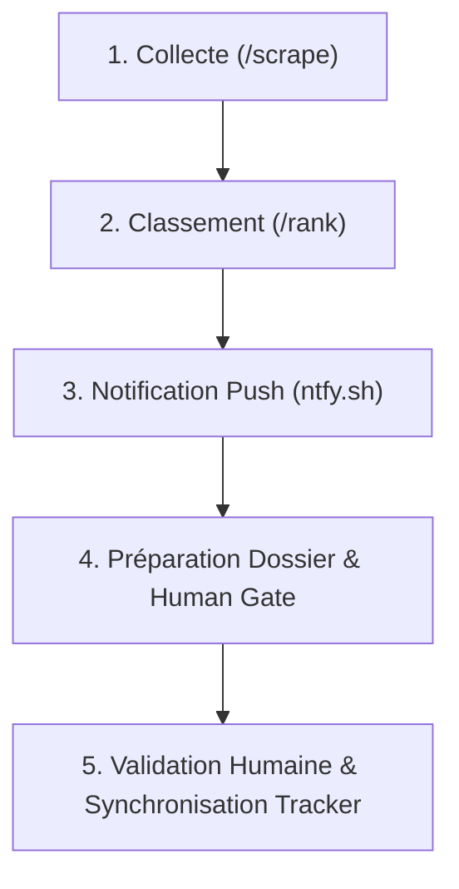

# 🚀 Guide Utilisateur & Manuel Opérationnel
## Système d'Automatisation de Recherche d'Emploi par IA

> **Candidat :** Amine Arheche (Fès, Maroc)  
> **Profil cible :** Développeur Full-Stack / Python IA & Support Technique N2 / Relation Client  
> **Contraintes géographiques :** Présentiel à **Fès** ou télétravail **100% Remote** uniquement (veto strict sur les autres villes)

---

## 📑 Sommaire
1. [Architecture & Principes Directeurs](#1-architecture--principes-directeurs)
2. [Flux de Travail Quotidien (Workflow en 5 étapes)](#2-flux-de-travail-quotidien-workflow-en-5-étapes)
3. [Commandes Essentielles (CLI)](#3-commandes-essentielles-cli)
4. [Tableau de Bord Visuel Interactif](#4-tableau-de-bord-visuel-interactif)
5. [Notifications Mobiles Instantanées (ntfy.sh)](#5-notifications-mobiles-instantanées-ntfysh)
6. [Garantie Human Approval Gate (Sécurité & Éthique)](#6-garantie-human-approval-gate-sécurité--éthique)
7. [Gestion des Secrets & Confidentialité](#7-gestion-des-secrets--confidentialité)

---

## 1. Architecture & Principes Directeurs

Le système est conçu selon une architecture modulaire et étanche :
- **Source unique de vérité :** Votre profil canonique est consigné dans `.claude/skills/job-application-assistant/01-candidate-profile.md`. Aucune compétence, date ou diplôme n'est inventé lors de la rédaction.
- **Zéro hallucination (Strict Grounding) :** Toutes les candidatures s'appuient uniquement sur vos faits réels (DTS ISTA Ifrane, CISCO Python Essentials, Concentrix, Freelance).
- **Veto géographique automatisé :** Seules les offres à Fès ou 100% remote passent le filtre. Toute offre en présentiel à Casablanca, Rabat, Tanger ou Skhirat est automatiquement disqualifiée.
- **Human Approval Gate :** Aucune candidature n'est envoyée sans votre feu vert explicite.

---

## 2. Flux de Travail Quotidien (Workflow en 5 étapes)



### Étape 1 : Collecter les nouvelles offres
Lancez le scraper des portails marocains (ReKrute, MonCallCenter) :
```bash
python tools/scrape_morocco.py
```

### Étape 2 : Évaluer et classer les offres
Appliquez le barème de notation et le veto géographique :
```bash
python tools/rank_evaluator.py
python tools/show_shortlist.py
```

### Étape 3 : Recevoir les alertes instantanées
Envoyez les alertes push directement sur votre téléphone pour les offres ≥ 70/100 :
```bash
python tools/push_notifier.py
```

### Étape 4 : Générer les dossiers de candidature sur mesure
Assemblez le CV (2 pages ATS), la lettre (1 page) et les formulaires pré-remplis :
```bash
python tools/application_gate.py --top 3
```

### Étape 5 : Réviser et valider avant envoi
Consultez le dossier préparé dans `documents/applications/<entreprise>_<poste>/`, puis donnez votre accord :
```bash
python tools/application_gate.py --approve "alten_maroc_développeur_python_ia"
python tools/sync_tracker.py --sync
```

---

## 3. Commandes Essentielles (CLI)

| Action | Commande | Description |
| :--- | :--- | :--- |
| **Scraper le Maroc** | `python tools/scrape_morocco.py` | Collecte ReKrute & MonCallCenter |
| **Classer les offres** | `python tools/rank_evaluator.py` | Calcule les scores et verdicts |
| **Afficher la shortlist** | `python tools/show_shortlist.py` | Affiche les offres éligibles (Fès/Remote) |
| **Notifier sur mobile** | `python tools/push_notifier.py` | Envoie les notifications push (ntfy.sh) |
| **Générer CV & Lettre** | `python tools/gemini_drafter.py --top 3` | Rédige et compile les PDFs |
| **Assembler le dossier** | `python tools/application_gate.py --top 3` | Prépare les fichiers formulaires et PDFs |
| **Valider l'envoi** | `python tools/application_gate.py --approve <id>` | Enregistre votre accord formel |
| **Synchroniser le tracker**| `python tools/sync_tracker.py --sync` | Met à jour `job_search_tracker.csv` |
| **Vérifier un PDF** | `python tools/verify_pdf.py <fichier.pdf>` | Vérifie la couche texte ATS et les dates |

---

## 4. Tableau de Bord Visuel Interactif

Un tableau de bord web complet est inclus dans le projet pour piloter visuellement l'ensemble du pipeline.

### Lancement du serveur :
```bash
node server.js
```
Ouvrez votre navigateur sur : **`http://localhost:3010`**

### Fonctionnalités disponibles sur le Dashboard :
- **Suivi du Funnel :** Visualisation des taux de conversion (Drafted -> Applied -> Interview -> Offer).
- **Offres en Direct :** Consultation des offres marocaines scrapées avec filtrage instantané.
- **Dossiers de Candidature :** Accès direct aux CVs compilés, lettres et réponses aux formulaires.
- **Simulateur d'Entretien :** Questions techniques et comportementales STAR prêtes pour chaque entreprise.

---

## 5. Notifications Mobiles Instantanées (ntfy.sh)

Le système utilise **ntfy.sh**, une solution 100% gratuite, open-source et sans création de compte :
1. Installez l'application **ntfy** sur votre smartphone (disponible sur [Google Play](https://play.google.com/store/apps/details?id=io.heckel.ntfy) et [App Store](https://apps.apple.com/app/ntfy/id1625396347)).
2. Abonnez-vous au sujet : **`amine_jobs_alert_private_channel`** (ou celui configuré dans votre `.env`).
3. Dès qu'une offre à Fès ou Remote dépasse 70/100, vous recevez une notification avec :
   - Le score et le verdict
   - Les points forts et de vigilance
   - Le bouton pour ouvrir directement l'offre

---

## 6. Garantie Human Approval Gate (Sécurité & Éthique)

Le principe **Human-in-the-Loop** est strictement programmé :
- L'agent d'IA **ne transmet jamais de formulaire de façon autonome**.
- Chaque dossier est déposé dans `documents/applications/<dossier>/` :
  - `CV_Amine_Arheche_<entreprise>.pdf`
  - `Lettre_Motivation_Amine_Arheche_<entreprise>.pdf`
  - `form_answers.txt` (textes prêts à copier-coller pour les questions de pitch, motivation et salaire).
- Vous conservez le contrôle total sur ce qui est envoyé aux recruteurs.

---

## 7. Gestion des Secrets & Confidentialité

- Le fichier `.env` conserve votre clé `GEMINI_API_KEY` (gratuite sur [Google AI Studio](https://aistudio.google.com/)).
- Vos coordonnées personnelles, les logs de candidatures (`applications_log.json`, `notified_jobs.json`) et vos dossiers de candidature sont strictement exclus de Git via `.gitignore`.
- Les scripts de contrôle de sécurité (`tools/security_guards.py`) veillent automatiquement à empêcher toute fuite de données privées.
